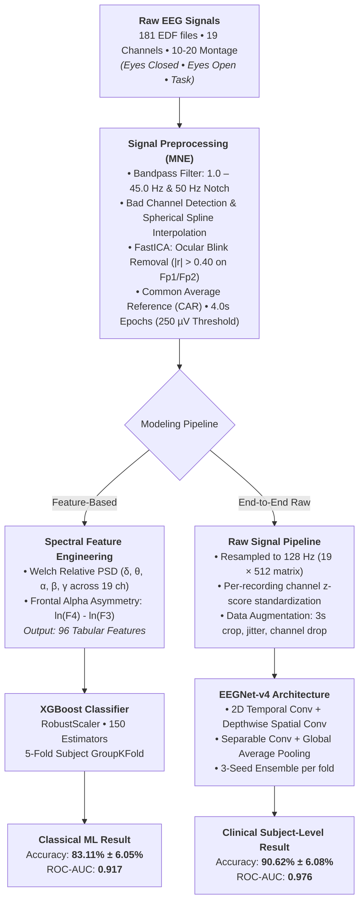

# Major Depressive Disorder (MDD) EEG Classification

An end-to-end machine learning and deep learning framework for classifying **Major Depressive Disorder (MDD)** versus **Healthy Controls** using 19-channel scalp Electroencephalography (EEG).

---

## 🏗️ Architecture Overview



---

## 🛠️ Tech Stack

- **Core & Numerics**: Python 3.10+, NumPy, SciPy
- **Signal Processing**: [MNE-Python](https://mne.tools/) (Filtering, ICA, montage, epoching)
- **Classical Machine Learning**: Scikit-Learn, XGBoost
- **Deep Learning**: PyTorch (EEGNet-v4, OneCycleLR schedule, mixed precision support)
- **Data & Formats**: EDF (European Data Format), compressed NPZ archives

---

## 📊 Dataset Description

The project uses the benchmark **Mumtaz et al. MDD EEG dataset**:

- **Subjects**: 65 total participants
  - **34 MDD** patients (clinically diagnosed via DSM-IV / HAM-D criteria)
  - **31 Healthy Controls**
- **Recordings**: 181 `.edf` files across 3 recording protocols:
  1. **EC (Eyes Closed)**: Resting-state baseline
  2. **EO (Eyes Open)**: Visual fixation resting-state
  3. **TASK**: Active cognitive / arithmetic mental task
- **Montage**: 19 scalp channels (`Fp1`, `Fp2`, `F7`, `F3`, `Fz`, `F4`, `F8`, `T3`, `C3`, `Cz`, `C4`, `T4`, `T5`, `P3`, `Pz`, `P4`, `T6`, `O1`, `O2`) following the International 10-20 standard.

---

## 📁 File Structure & Key Functions

```
├── data/
│   ├── raw/                 # 181 raw .edf files (Mumtaz dataset)
│   ├── metadata.csv         # Mapping of files to subjects, conditions, and labels
│   └── processed/           # Intermediate processed files
├── eeg_epochs_128hz.npz      # Cached 128 Hz preprocessed epochs array (23,667 x 19 x 512)
├── training.py              # Standalone classical ML pipeline (XGBoost)
├── eeg_nn.py                # Standalone deep learning pipeline (EEGNet)
├── data_inspection.ipynb     # Initial EDA on EDF headers and sampling rates
├── preprocessing.ipynb       # MNE cleaning, filtering, and ICA experimentation
├── signal_inspection.ipynb   # Time-frequency signal validation
├── feature_extraction.ipynb  # Welch PSD and band-power extraction
├── feature_extraction2.ipynb # Secondary feature engineering experiments
├── mlmodel.ipynb            # Interactive notebook for XGBoost training
└── train_dl.ipynb           # Interactive notebook for EEGNet training
```

### Key Python Scripts & Functions

#### 1. `training.py` (Classical ML Pipeline)
- `preprocess_and_clean_raw(file_path, scalp_channels)`: Loads EDF, applies $1.0-45.0\text{ Hz}$ bandpass and $50\text{ Hz}$ notch filters, detects/interpolates bad channels, fits FastICA to subtract blink components using $Fp1/Fp2$ correlation, applies Common Average Referencing (CAR), and slices into 4s epochs.
- `extract_epoch_features(epochs)`: Computes Welch Power Spectral Density across 5 bands ($\delta, \theta, \alpha, \beta, \gamma$) for 19 channels (95 features) plus **Frontal Alpha Asymmetry** ($\text{FAA} = \ln(F4) - \ln(F3)$), yielding 96 features.
- `build_dataset(data_dir, scalp_channels)`: Iterates over all raw files, extracts feature matrices, and extracts subject IDs to prevent data leakage.
- `train_classical_ml(X_ml, y, groups)`: Normalizes with `RobustScaler` and trains XGBoost using 5-fold subject-stratified `GroupKFold`.

#### 2. `eeg_nn.py` (Deep Learning Pipeline)
- `build_or_load_cache()`: Downsamples cleaned epochs to $128\text{ Hz}$ ($512$ points per channel), applies per-recording z-score standardization, and caches `X`, `y`, and `groups` to `eeg_epochs_128hz.npz`.
- `EEGNet(nn.Module)`: PyTorch model using 2D temporal convolution ($1\times64$), depthwise spatial convolution ($19\times1$) to learn cross-channel spatial filters, separable convolution, and global average pooling.
- `augment(xb)`: Dynamic training augmentation including random 3-second temporal crops ($384$ samples), amplitude jitter ($\times 0.8-1.2$), Gaussian noise, and spatial channel dropout.
- `train_one(Xtr, ytr, seed)`: Trains one model instance with class-weighted cross-entropy loss, label smoothing ($0.1$), and a `OneCycleLR` schedule.
- `subject_level(probs, y, groups)`: Aggregates epoch-level predictions across all epochs belonging to each subject (soft-voting consensus).

---

## 📈 Results Summary

To guarantee real-world generalization, all models are evaluated using **5-Fold Subject Cross-Validation** (no subject's data is shared between training and test sets):

| Approach | Model | Input | Accuracy | F1-Score | ROC-AUC |
| :--- | :--- | :--- | :---: | :---: | :---: |
| **Classical ML** | XGBoost | 96 Spectral & FAA Features | **83.11% ± 6.05%** | 0.839 | 0.917 |
| **Deep Learning** | EEGNet-v4 (Epoch-Level) | Raw 128 Hz Epochs $(19 \times 512)$ | **88.39% ± 4.98%** | 0.881 | 0.955 |
| **Deep Learning** | EEGNet-v4 (Subject-Level) | Averaged Epoch Probabilities | **90.62% ± 6.08%** | **0.901** | **0.976** |

---